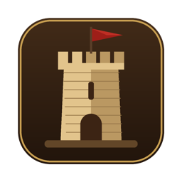
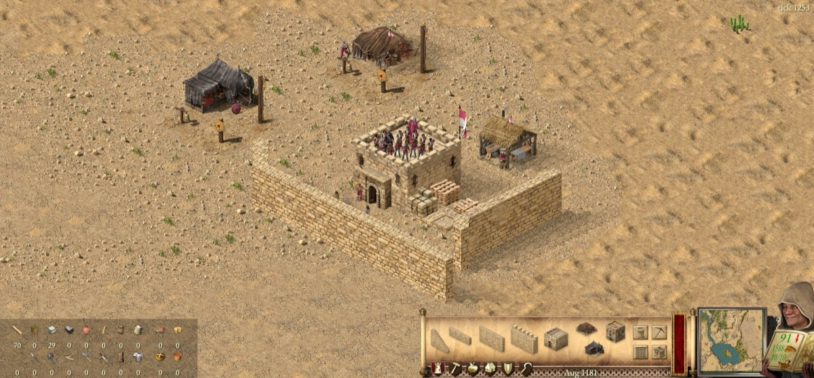
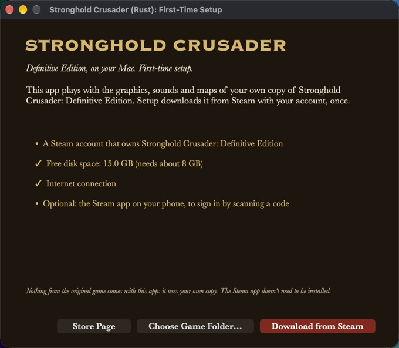
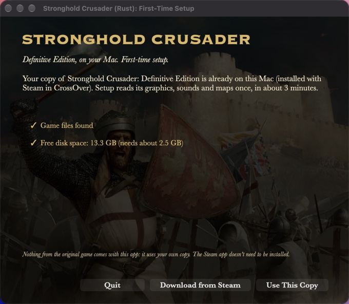
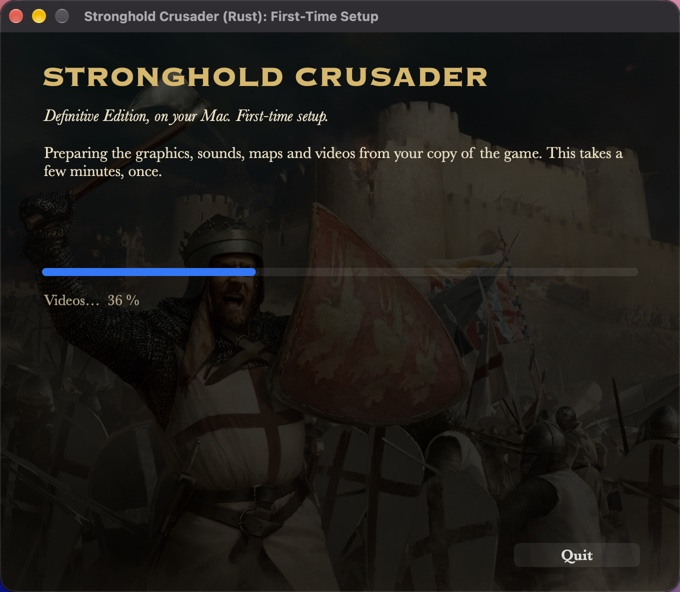

<h1 align="center">Strong Hold</h1>

<b>A native Mac engine for Stronghold Crusader: Definitive Edition.</b> 
No Windows, no CrossOver: open the app, sign in to Steam once, play.

<a href="https://github.com/YannickAaron/Strong-Hold/releases/latest/download/Strong-Hold.dmg"><b>Download for Mac</b></a> · <a href="https://yannickaaron.github.io/Strong-Hold/">Website</a> · <a href="https://github.com/YannickAaron/Strong-Hold-source">Source code</a>

**Built in Rust, native on Apple Silicon.** The original game is a Unity front end driving a Windows-only
simulation library. This project rebuilds that simulation from scratch in Rust and draws it with Metal: no Windows,
no CrossOver, no emulation. Your castles, your economy and the lords you fight run as native code, checked tick by
tick against the original.

| 120 fps | 12× fast-forward | ~1 s | 41 MB |
|:---:|:---:|:---:|:---:|
| steady frame rate | about 500 ticks a second (normal: 40) | to load a save | download, engine only |

[▶ Watch it run](https://yannickaaron.github.io/Strong-Hold/#video) · measured on an M1 Max

## You need

- A Mac with Apple Silicon (M1 or newer), macOS 12 or newer
- [Stronghold Crusader: Definitive Edition](https://store.steampowered.com/app/3024040/) on your Steam account
- About 9.5 GB of free disk space
- Optional: the Steam app on your phone, to sign in by scanning a code

## Install

1. [Download the app](https://github.com/YannickAaron/Strong-Hold/releases/latest/download/Strong-Hold.dmg) (always the newest version; older ones: [Releases](https://github.com/YannickAaron/Strong-Hold/releases)).
2. Open it and drag **Strong Hold** into Applications.
3. The first time only, because the app isn't notarized by Apple yet:
   - macOS 14: right-click the app and choose **Open**.
   - macOS 15 or newer: open it once, then go to System Settings › Privacy & Security and click **Open Anyway**.
4. Follow the setup window. Afterwards the app opens straight to the main menu.

## First start

The app brings the engine, not the game. The first time you open it, a setup window gets the graphics, sounds, maps
and videos from **your own copy** of the game, once:

| | |
|---|---|
|  | **Check, then sign in to Steam.** Setup checks for a Steam account that owns the game, about 9.5 GB free and an internet connection. Then scan a code with the Steam app on your phone, or use your user name, password and Steam Guard code. The Steam app for Mac doesn't need to be installed. |
|  | **Already on this Mac?** A copy of the game found on the Mac (for example in CrossOver) is used directly: one click, no download. |
|  | **Download and prepare.** Your copy downloads (about 6.2 GB), then its assets are prepared for the native engine in a few minutes. |

Your Steam sign-in goes to Steam through Valve's open-source DepotDownloader, which the app carries. Your password is
passed to it once and never saved. The game's files go to `~/Library/Application Support/Strong Hold`.

## What the app does on your Mac

**Internet: three things, nothing else.**
1. **Updates**, from GitHub only. Once a day and when you press Check for updates in Extras, the app asks for the latest
   release and the lists of published custom lords and maps. It sends only the app's version (GitHub sees your IP
   address, like any website). It downloads only when you click Update (the new app, ~13 MB) or Get / Update on a lord
   or a map, and installs
   nothing whose SHA-256 differs from the one GitHub lists for that file.
2. **Steam**, only when you choose to download the game: Valve's open-source DepotDownloader signs in and downloads from
   Steam. The password you type goes to it once, through its input: never saved, never written to the log, never on a
   command line.
3. **LAN games**, only when you host or join: your local network (UDP port 47777 to find games, TCP 47778 to play).

**No telemetry**, no analytics, no ads, no account of ours.

**Files:** the app writes only to `~/Library/Application Support/Strong Hold` (your copy of the game, the prepared
assets, settings, saves, maps, imported lords) and `~/Library/Logs/Strong Hold.log`, and, when you click Update, its
own app: the new version goes next to it, and Restart to update swaps the two. A copy of the game in CrossOver is only read
(its saves show up in Load Game too, and can't be deleted from here), and so is its CustomLords folder; a lord's .zip you import is only read. DepotDownloader (.NET) may leave an empty `IsolatedStorage` folder next to ours. To
uninstall, drag the app to the Bin and delete those folders.

**Other programs** it starts: DepotDownloader (Steam download), macOS's `curl` (update check and downloads), `shasum`
(checking them), `tar`, `hdiutil`, `ditto` and `codesign` (unpacking and checking an update), `open` (when you click to
show a folder or the releases page, and to start the updated app), `date` (once, for your time zone on the save list).

**Check it yourself:** the [source code](https://github.com/YannickAaron/Strong-Hold-source) of everything above (all of the app except the simulation, which has
no network or file code), and every release's SHA-256 and VirusTotal scan.

## What it supports

| | |
|---|---|
| **Single player** | Skirmish against AI lords (Advanced Skirmish Options, Extreme, King of the Hill, your own lords from the game's CustomLords folder), the historical campaigns with story pages, the Crusader Trail with Sands of Time, ranks, Customize, Skirmish Masters and custom trails, the tutorial, Free Build with events and powers |
| **Multiplayer** | Local network (LAN) games, King of the Hill, co-op Crusader Trail, chat to chosen players or teams, insults, pause, game speed for everyone, multiplayer saves |
| **Map Editor** | Shape the land (heights, ground types, water, trees, rocks, animals), place keeps, buildings, walls and troops, starting goods; your maps play in Custom Skirmish and Sandbox |
| **Your lord** | Player name, colour and coat of arms editor, shown on troops, flags, lobby, trails and score screens |
| **The game's own feel** | Original music, speech, advisor and lord videos, win/lose videos, in-game Help pages, score screens with graphs, reports, building panels, market trading, tooltips, the original hotkeys |
| **On the Mac** | Native Metal at 120 fps, 12× fast-forward, menu bar, trackpad zoom and rotate, full screen / borderless / windowed, saves in your Library, updates itself in two clicks (and your custom lords) |

The port is in active development; parts of the simulation are still being checked against the original.
Not yet: online multiplayer (Steam), Intel Macs.

## Beyond the original

A fan port can add what the original never had. Everything here lives outside the simulation, which stays byte for
byte the original's, so saves, replays and LAN games stay exact. Rule changes are opt-in.

| | |
|---|---|
| **Custom lords** | AI lords from a .zip with their own face, voice, castles, story video and reactions to the battle; Lord David von Lindschied is the first, and published lords install and update from Extras |
| **Extended rules** | An opt-in lobby switch for new units and rules; first in: the Sassanid Knight (a lancer whose first blow after a six-tile charge strikes twice as hard) and the Sassanid Stable; classic games untouched |
| **Modes and lobby** | King of the Hill (short, normal, long), a clear game mode picker, Competitive Start, custom maps that travel to everyone in a LAN game, a Maps catalog in Extras |
| **Controls** | Click one unit out of a group, filter a selection by troop type, right-click rally points, add to a group, select all of a type, more hotkeys, units on an even clock when the Mac is busy |
| **Sturdier multiplayer** | A new host takes over when the host leaves, the host checks every message before it reaches the game, a frozen peer no longer freezes everyone, dropped players rejoin, spectators follow along |
| **Tools** | Replays of every game, a frame trace and judder score for tuning, an in-app updater, a simulation proven tick by tick against the original engine |

## Release history

Every release: [Releases](https://github.com/YannickAaron/Strong-Hold/releases). Update in the app: click the update
button in the main menu or Extras, then Restart to update (if the app can't replace itself, e.g. run from the DMG, the
button opens the download page instead). Your game files, settings and saves stay.

| Version | Date | What's new |
|---|---|---|
| [0.17.1](https://github.com/YannickAaron/Strong-Hold/releases/tag/v0.17.1) | 25 Oct 2026 | Fixes: scrolling up by pushing the mouse against the top of the screen works in full screen (the map kept still once the menu bar took the cursor); the Options screen no longer replays the button click sound while you hover a button. |
| [0.17.0](https://github.com/YannickAaron/Strong-Hold/releases/tag/v0.17.0) | 25 Oct 2026 | Mouse players: mice with smooth scrolling (Logitech Options+, most Bluetooth mice) zoom with the wheel again instead of panning; a Magic Mouse pans, or zooms like the original with View > Trackpad Scrolling Pans off. Options > Controls: Scroll speed and Push map scrolling now apply. PageUp / PageDown zoom the minimap out to the whole map and back in, as in the original. The app checks for a new version at every start (not once a day). Custom lords can require a minimum app version: an older app refuses the lord and points you to the update instead of loading it wrong. |
| [0.16.0](https://github.com/YannickAaron/Strong-Hold/releases/tag/v0.16.0) | 25 Oct 2026 | Lord David von Lindschied is a real opponent now: his army keeps growing (as strong as Richard's), he marches on you with siege waves of 20 to 30 crossbowmen and swordsmen with engines once he is ready, and a levy of archers holds his walls meanwhile. With Extended rules his swordsmen raid only farms nobody guards, never past your troops, and ride home after. He speaks up when your army reaches his walls and after hard fights, his reactions show reliably (also after loading a save), his clips play smoothly and all his lines are shorter and as loud as the other lords'. Get the new version in Extras. |
| [0.15.1](https://github.com/YannickAaron/Strong-Hold/releases/tag/v0.15.1) | 24 Oct 2026 | Fix: the no-workers sign shows again over buildings that are missing a worker. |
| [0.15.0](https://github.com/YannickAaron/Strong-Hold/releases/tag/v0.15.0) | 24 Oct 2026 | Extended rules: an opt-in switch in the skirmish and LAN lobby with the Sassanid Knight, a lancer whose first blow after a six-tile charge strikes twice as hard, trained at the new Sassanid Stable. In the lobby: a clear game mode picker, Competitive Start, and search, sort and Show Completed in the Custom Scenarios and Free Build lists. In game: the standings (Order of Merit) panel, ally ping (Alt+P) with its marker button by the minimap, right-click rally points, add-to-group and select-all-of-a-type hotkeys, custom maps that travel over LAN and a Maps catalog in Extras, and the Classic mouse-wheel, radar zoom, planned-moat and spoken-greeting options now applied. As in the Definitive Edition: the siege tent shows at the cursor when engineers place an engine, Quit Mission and Exit Crusader ask first, the mission briefing opens in skirmishes too, buildings and troops in your player colour, hover texts on the side tabs, and the mercenary post and armoury panels tidied. Fixes: letters no longer vanish from menus after a long session, the Keeps menu is locked in games (a stray keep could move yours), smoother camera and walking under load. Lord David von Lindschied reacts to the battle with 16 new clips, carries his own banner and guard, and no longer sells his wheat and flour. macOS Game Mode in full screen. |
| [0.14.0](https://github.com/YannickAaron/Strong-Hold/releases/tag/v0.14.0) | 24 Oct 2026 | The app updates itself: Update in the main menu or Extras downloads the new version (about 13 MB), checks it, and Restart to update installs it, so no more new DMG for every release. Custom lords from the web: Extras lists the published lords with Get / Update, and the main menu tells you when one of yours has a newer version (Lord David von Lindschied is the first). LAN games are sturdier: the host checks every player's messages, a player who stops responding no longer freezes the host, and rejoining and loading saved LAN games work again. Saves, settings and maps can't be lost to a crash mid-write, a failed game load shows an error instead of loading forever, and the Map Editor no longer quits on a bad map |
| [0.13.4](https://github.com/YannickAaron/Strong-Hold/releases/tag/v0.13.4) | 24 Oct 2026 | Catapults, siege towers, battering rams and fire ballistas swing round to a new direction as in the original instead of snapping |
| [0.13.3](https://github.com/YannickAaron/Strong-Hold/releases/tag/v0.13.3) | 24 Oct 2026 | An assassin's climbing rope fades out as in the original instead of vanishing at once |
| [0.13.2](https://github.com/YannickAaron/Strong-Hold/releases/tag/v0.13.2) | 24 Oct 2026 | Horses (and every walking unit) move evenly in a live game, also in big armies on a full screen: no more two-steps-then-pause judder when macOS paces frames unevenly |
| [0.13.1](https://github.com/YannickAaron/Strong-Hold/releases/tag/v0.13.1) | 24 Oct 2026 | LAN: the game no longer can freeze for everyone when the host quits a game of three or more players |
| [0.13.0](https://github.com/YannickAaron/Strong-Hold/releases/tag/v0.13.0) | 24 Oct 2026 | A new Extras button on the main menu: this build's version and folders, Check for updates, the patch notes, and your custom lords with Import lord (.zip). Importing moved here from the skirmish's Add AI panel: an imported lord simply joins the Add AI faces, and a .zip dropped on the window opens Extras with the result |
| [0.12.3](https://github.com/YannickAaron/Strong-Hold/releases/tag/v0.12.3) | 23 Oct 2026 | Pressing a build hotkey the game refuses (walls without stone) no longer shows a red outline with a "Not ported in the sim yet" note at the cursor |
| [0.12.2](https://github.com/YannickAaron/Strong-Hold/releases/tag/v0.12.2) | 23 Oct 2026 | Knights and other horses ride smoothly, also in big armies: no more stop-and-go on every step, no jumping back in a crowd, and they keep gliding when a large battle slows the game down |
| [0.12.1](https://github.com/YannickAaron/Strong-Hold/releases/tag/v0.12.1) | 23 Oct 2026 | Importing a lord from a .zip in Add AI now opens his story page right away and plays his story video when he brings one. Custom lords can bring a full-screen story video ("Watch his story" on their page). A custom lord's keep, scores and stats now show his own name instead of the Rat's. A first custom lord to try, Lord David von Lindschied, is attached to the release as a .zip |
| [0.12.0](https://github.com/YannickAaron/Strong-Hold/releases/tag/v0.12.0) | 23 Oct 2026 | Custom lords join the Add AI faces next to the built-in lords: a red (!) on a face opens his story page, and one Import tile adds a lord from a .zip. Custom lords work in LAN games and can bring their own figure on the map. Horses no longer jerk backwards while they run. The floating gold and popularity numbers over keeps and houses show their icon and number again instead of an empty scroll |
| [0.11.2](https://github.com/YannickAaron/Strong-Hold/releases/tag/v0.11.2) | 23 Oct 2026 | Troops standing just behind a building now stay behind it instead of being drawn over its roof; archers on keeps stand behind the battlements. The download is about 5 MB bigger: the art for the coming Sassanid Knight is already inside |
| [0.11.1](https://github.com/YannickAaron/Strong-Hold/releases/tag/v0.11.1) | 23 Oct 2026 | Troops walking behind buildings now go behind them, the right-click menu no longer opens when you order your lord with the modern controls, and the move / attack cursor is the original's size on Retina screens |
| [0.11.0](https://github.com/YannickAaron/Strong-Hold/releases/tag/v0.11.0) | 23 Oct 2026 | Custom AI lords: lords from the game's CustomLords / CustomMedia folders join skirmishes with their own face, voice and videos. Click one unit out of a selected group to command it alone; click a troop type in the troops panel to keep only that type, right-click it to drop it |
| [0.10.0](https://github.com/YannickAaron/Strong-Hold/releases/tag/v0.10.0) | 23 Oct 2026 | King of the Hill: a new skirmish and LAN mode with a guarded tower on the hill to conquer and hold, and AI lords that fight for it. Buttons, checkboxes, panels and text boxes in the game's own red-and-gold look. For King of the Hill over LAN everyone needs 0.10.0 |
| [0.9.0](https://github.com/YannickAaron/Strong-Hold/releases/tag/v0.9.0) | 23 Oct 2026 | Change the game speed during LAN games and co-op missions (+ / − keys or Options): it changes for every player (everyone needs 0.9.0) |
| [0.8.1](https://github.com/YannickAaron/Strong-Hold/releases/tag/v0.8.1) | 22 Oct 2026 | No more shell script inside the app (one virus scanner mistook it for a trojan), the source code of everything except the simulation is public, and a page on what the app does on your Mac |
| [0.8.0](https://github.com/YannickAaron/Strong-Hold/releases/tag/v0.8.0) | 22 Oct 2026 | Map Editor part 2: keeps, buildings, walls, troops and starting goods per player; editor maps play in Custom Skirmish. Coat of arms editor, type your player name. LAN shares coats of arms (everyone needs 0.8.0) |
| [0.7.0](https://github.com/YannickAaron/Strong-Hold/releases/tag/v0.7.0) | 22 Oct 2026 | Sands of Time results after each trail win, trail completion screens, campaign missions wait for the advisor before the mission-over screen, "New game files available" downloads only what's missing |
| [0.6.0](https://github.com/YannickAaron/Strong-Hold/releases/tag/v0.6.0) | 22 Oct 2026 | Advisor and lord videos over the minimap, full-screen win/lose videos, victory and defeat speech, building sketches, tutorial arrows, building tooltips, the original on-screen texts, multiplayer chat with insults |
| [0.5.0](https://github.com/YannickAaron/Strong-Hold/releases/tag/v0.5.0) | 22 Oct 2026 | Map Editor part 1: map size and type, shape the land, water, trees, rocks, animals; save and load; your maps in the Sandbox |
| [0.4.0](https://github.com/YannickAaron/Strong-Hold/releases/tag/v0.4.0) | 21 Oct 2026 | Your colour everywhere, Allies panel, Free Build events and powers, control groups, Advanced Skirmish Options, exact projectile maths so LAN games stay in sync |
| [0.3.0](https://github.com/YannickAaron/Strong-Hold/releases/tag/v0.3.0) | 21 Oct 2026 | In-game Help, score screen, every building panel, market price list and auto trading, the original hotkeys, save dialog, credits, display modes and many options |
| [0.2.0](https://github.com/YannickAaron/Strong-Hold/releases/tag/v0.2.0) | 21 Oct 2026 | New name *Strong Hold*. Crusader Trail, all historical campaign missions, Reports, full troop orders, original camera, LAN chat, pause, saves and co-op trail, menu and mission sounds |
| [0.1.1](https://github.com/YannickAaron/Strong-Hold/releases/tag/v0.1.1) | 21 Oct 2026 | "New version available" notice on the main menu, co-op ally castles, AI siege and squads, tutorial |
| [0.1.0](https://github.com/YannickAaron/Strong-Hold/releases/tag/v0.1.0) | 20 Oct 2026 | First release as *Stronghold Crusader (Rust)*: the native engine, first-start setup (your copy from CrossOver/Steam, a folder, or a Steam download), skirmish, campaigns, sandbox, LAN |

Something wrong? [Open an issue](https://github.com/YannickAaron/Strong-Hold/issues) and attach
`~/Library/Logs/Strong Hold.log`.

## Legal

Strong Hold is an unofficial, free, non-commercial fan project. It is not affiliated with, endorsed or sponsored by
Firefly Studios. Stronghold and Stronghold Crusader are trademarks of Firefly Studios; they are used here only to say
which game this engine works with. The app contains no files from the game: it needs your own copy of Stronghold
Crusader: Definitive Edition, bought on Steam, and reads the graphics, sounds and maps from that copy on your Mac.

Firefly Studios, or anyone with a concern about this project: please
[open an issue](https://github.com/YannickAaron/Strong-Hold/issues) and it will be answered promptly.

The app includes [DepotDownloader](https://github.com/SteamRE/DepotDownloader) 3.4.0 by SteamRE, licensed GPL-2.0;
its licence is inside the app (`Contents/Resources/LICENSE-DepotDownloader.txt`) and its source is at
https://github.com/SteamRE/DepotDownloader/tree/DepotDownloader_3.4.0 (also attached to every release).

The app also includes open-source Rust libraries and libvpx; their licences are in
`Contents/Resources/THIRD-PARTY-NOTICES.txt` inside the app.
